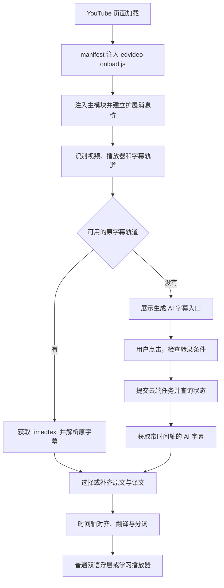
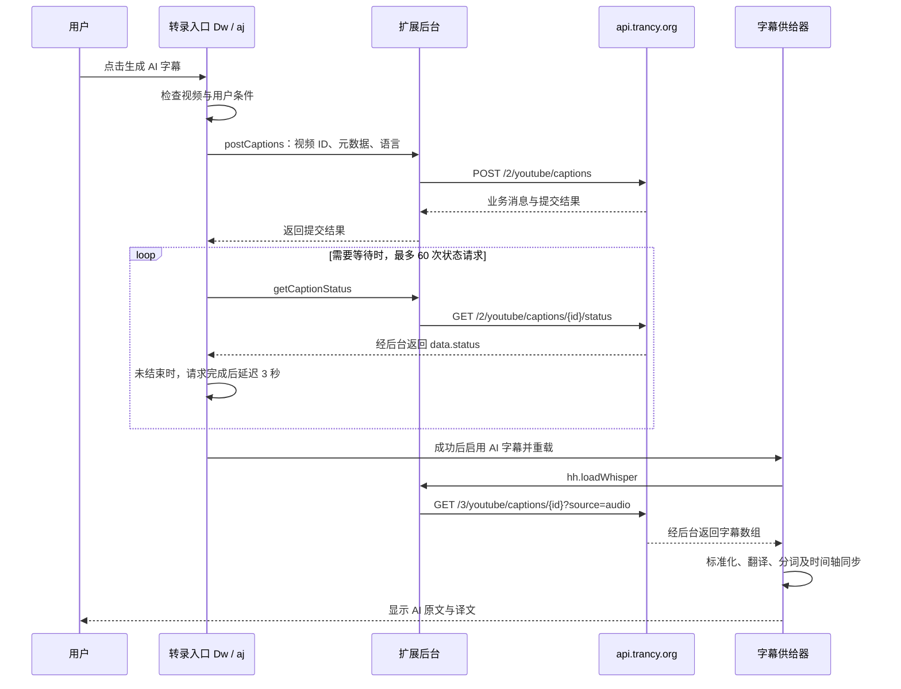

# Trancy Local

Chrome Manifest V3 扩展，提供 AI 翻译、双语字幕及语言学习功能。

本 README 记录当前 **7.9.4** 代码中 YouTube 原字幕与 AI 转录的完整调用链，供后续维护和 B 站无字幕视频接入使用。

## Windows 桌面字幕

新增 [PyQt6 桌面应用](desktop/README.md)，只保留 **PotPlayer** 本地视频字幕与 **B 站 / YouTube** 网页视频字幕。系统声音捕获及实时语音翻译已移除；优先读取已有字幕，缺字幕时只识别播放位置附近的音频。桌面字幕可置顶、跨窗口拖动，并显示中英双语；本地播放器只适配 PotPlayer。

桌面端复用 `D:\dev\SubtitleService` 的本地识别模型，翻译沿用插件的 Google 实现或通过浏览器桥接调用插件当前字幕引擎。桌面端生成字幕不要求原视频已有字幕；翻译参考原插件按播放位置优先，首批 3 句、后续最多 30 句，提前准备最多 90 句，原文、译文与已识别范围可以部分缓存。下文关于 `api.trancy.org` 的说明仍指原扩展的云端转录流程。

网页连接使用独立的 **Trancy 桌面字幕连接器**，ID 为 `phkekicmpkiinghhklcoanjjdnccdeod`，运行目录为 `desktop/data/desktop-connector`，可以与原 Trancy 同时安装。

桌面连接器 0.1.3 修复 B 站已有字幕仍进入语音识别的问题：读取播放器 `aid` 元数据，复用当前视频已经加载的字幕正文；网页原字幕失败／超时仅重试文本，确认没有字幕轨时才获取音频、加载识别模型。更新后需重新加载连接器、刷新视频页并重启桌面应用。

当前电脑可双击 [启动桌面字幕.vbs](desktop/启动桌面字幕.vbs)。安装、浏览器扩展运行副本与验证情况见 [桌面使用说明](desktop/README.md)。

桌面端现支持第一期 **B 站本地英文配音**：开关每次启动默认关闭；开启后提前生成英文字幕的 Windows 本地语音，音频准备好且网页静音确认成功后播放。暂停、缓冲、跳转与倍速跟随视频；关闭、停止、换视频或断连恢复原有声音状态。此功能需要 0.1.4 连接器并刷新视频页面，使用方法与长句策略见[英文配音说明](desktop/README.md#b-站本地英文配音第一期)。

桌面配音已改为启用 Qt 6.10 以上的音高补偿，避免英文长句加速时音色随之变调；短句保持自然语速。当前电脑的启动器使用 `D:\dev\TrancyDesktop\.venv` 中的独立 Qt 6.11.2 环境，重启桌面软件即可生效。

## 1. 文档依据与适用范围

- 核对日期：2026-10-13，Asia/Shanghai。
- 代码基线：`f2c6256b7926ef04df6c76af9b9a46fac82afde9`。
- 当前仓库保存的是扩展的构建产物。主要业务代码在压缩后的 JavaScript 中，没有对应的云端服务源代码。
- 下文的接口、字段、分支与时间参数来自当前客户端源码。后端内部如何下载音频、采用什么识别模型、如何计费与调度，不能仅凭这些文件确认。
- 文档区分源码确认与实际接口检查；没有将未登录的接口检查写成转录成功，也没有将 B 站云端转录写成已实现功能。

| 情况 | 当前处理方式 |
| --- | --- |
| YouTube 有人工字幕 | 获取平台字幕轨道，解析时间轴，再使用平台译文或翻译引擎补齐译文 |
| YouTube 有平台自动字幕 | 仍走原字幕流程；`captionTracks` 中的 `kind: "asr"` 表示 YouTube 自己生成的字幕 |
| 有字幕，但没有设置的主字幕语言或译文语言 | 在已有轨道的基础上补齐语言；具体行为取决于普通双语浮层或学习播放器 |
| YouTube 原视频没有可用字幕 | 展示 AI 转录入口，由用户提交云端任务，查询状态并获取识别后的字幕 |
| 原字幕存在，用户主动选择 AI 转录 | 可切换到 AI 字幕；AI 转录不限于完全无字幕的视频 |
| B 站没有原字幕 | 当前原字幕监听不能生成语音识别字幕，需要另外接通任务提交、结果获取与显示链路 |

**YouTube 自带的自动字幕与本插件的 AI 转录是两条不同流程。** 前者使用 YouTube 的 `timedtext` 字幕；后者向 `api.trancy.org` 提交任务。

## 2. 共同入口：从页面加载到播放器

主要文件：

| 文件 | 作用 |
| --- | --- |
| [manifest.json](manifest.json) | 声明视频站点匹配范围、内容脚本、后台 Service Worker 和快捷键 |
| [assets/edvideo-onload.js](assets/edvideo-onload.js) | 在扩展隔离环境建立消息桥，向页面注入模块脚本 |
| [assets/edvideo-main.js](assets/edvideo-main.js) | 视频元数据、字幕获取、AI 转录入口、翻译、学习播放器与双语字幕界面 |
| [assets/background.js](assets/background.js) | 状态读取、鉴权请求转发、翻译调度与后台消息处理 |
| [assets/edvideo.css](assets/edvideo.css) | 播放器按钮、字幕浮层和学习界面的样式 |

入口链路：

1. `manifest.json` 在视频站点以 `document_start` 注入 `edvideo-onload.js` 与视频样式，并配置 `all_frames: true`。
2. `edvideo-onload.js` 使用 `chrome.runtime.getURL()` 注入 `edvideo-main.js`、`romanize-main.js`、`ld-main.js`。它们作为模块脚本在网页环境执行。
3. `Zt()` 根据页面地址识别站点；`Gt()` 判断可渲染的视频页面。当前 YouTube 页面判断包含 `watch`、`embed`、`/live/`。
4. 元数据单例 `A_` / `j_` / `P_` 读取视频 ID、标题、时长和字幕轨道，安装字幕请求监听。页面上可通过 `window.metacontext` 找到该单例。
5. 应用 `bootstrap()` 建立消息监听、播放器按钮与页面切换监听。普通双语浮层通过 `renderCaptionInner()` 渲染；学习播放器通过 `renderApp()` 渲染。
6. `og()` 对接具体站点的播放器操作，字幕时间与视频当前播放时间关联。



语言配置的含义：

| 字段 | 含义 |
| --- | --- |
| `setting.language.subtitle` | 学习语言／主字幕语言；通常对应字幕加载器的 `from`、转录接口的 `target` |
| `setting.language.translation` | 译文语言；通常对应加载器的 `to` |
| `setting.language.interface` | 界面语言；通过请求包装器写入 `x-locale`，不等于字幕目标语言 |
| `language`，转录提交时的可选字段 | 已知的原始音频语言；与 `target` 是不同字段 |

学习播放器在主字幕语言或译文语言为 `und` 时，会先打开语言设置，避免使用未配置语言加载字幕。

## 3. YouTube 有字幕：原字幕处理链路

### 3.1 发现字幕轨道

`A_.getYoutubeTracks()` 从当前 YouTube 播放器的 `getPlayerResponse()` 读取：

```text
ytInitialPlayerResponse
└─ captions
   └─ playerCaptionsTracklistRenderer
      └─ captionTracks[]
```

轨道中包含字幕请求地址、语言代码，以及区分平台自动字幕的 `kind` 等信息。元数据也保存在 `P_.context.ytInitialPlayerResponse` 中。

当前页面切换时需要重新核对播放器的视频 ID，防止把上一个视频的字幕轨道用于新视频。`getYoutubeTracks()` 至多进行 30 次、每次间隔 100 毫秒的身份检查；`hh.getPlayerResponse()` 另有自己的视频身份检查。

`addYoutubeListener()` 监听 `api/timedtext` 的 XHR 请求，按视频 ID 保存请求地址，并缓存可解析的 `json3` 原始响应。已有自动字幕也在这个监听范围内。

### 3.2 获取字幕正文

YouTube 字幕加载器为 `hh`，它继承通用轨道基类 `nh`。普通原字幕通过 `hh.load()` 获取，使用播放器轨道与已捕获的 `timedtext` 请求上下文。

字幕选择与获取的具体顺序：

1. 先检查页面内的轨道缓存；键区分视频、语言、人工／自动字幕偏好和动态翻译模式。
2. 读取 `captionTracks`。无轨道时抛出 `no caption tracks`。`waitPlayable()` 等待播放器进入可播放状态，必要时开启 YouTube 原生字幕。
3. 默认 `priorityHumanSubtitle = true`。当 `from` 和 `to` 都有非 ASR 轨道时，优先取这两条轨道。
4. 否则主轨依次尝试：`from` 的非 ASR 且没有 `name` 的轨道 → `from` 的非 ASR → `from` 的 ASR → 任意 `from` → 任意 `from/to` → 第一条轨道。
5. 代码还有特殊选择分支：存在 `trackName` 含 `CC` 的轨道且有 `from` 的 ASR 时，可能改选 ASR；关闭人工字幕偏好时也会尝试 ASR。因此不能将当前规则简写成无条件人工字幕优先。
6. 如果主轨可翻译且语言不是 `from`，生成带 `tlang=from` 的 YouTube 原生机器翻译请求，并保留未加 `tlang` 的原始轨作为失败回退。
7. 先取得主轨。学习播放器预先下载第二轨；普通浮层允许第二轨以 `pending` 形式异步到达，再合并译文。

`generateSource()` 以当前轨道的 `baseUrl` 为基础，优先借用页面捕获的原生请求参数；没有合适请求时读取 `window.ytcfg.get("DEVICE")` 与播放器 context config，补充 `fmt=json3` 及设备／播放器参数。

当前 YouTube 正常下载路径使用 **JSON3**；代码虽保留 XML 下载和通用 VTT 解析方法，但当前 `hh.download()` 没有将它们作为 JSON3 失败后的自动回退。

`downloadJSON3Caption()` 的正文获取不是简单的一次直接下载：

- 有 `playerTrack` 时先通过播放器 `setOption("captions", "track", ...)` 选择对应字幕轨。
- `acquireJSON3()` 优先匹配已捕获的同视频、同语言、同 `kind`、同 `tlang` 的 JSON3 原文。
- 允许 `allowSelfFetch`，或未能成功选择播放器轨道时，才按该分支直接 `fetch` 字幕 URL；原生请求中的 `pot/potc` 参数也可能被借用。
- 仍未取得有效正文时监听 `youtube.subtitle.loaded` / `youtube.subtitle.rejected`，等待原生请求，并按条件尝试切换轨道或开关字幕。
- 普通轨道默认等待 8 秒，`tlang` 轨道默认等待 5 秒；同轨带 `pot` 的请求仍在进行时可延长等待，默认总等待上限至少 20 秒。普通浮层外层另有 30 秒加载等待。
- `downloadJSON3Caption()` **抛错时**才尝试 `remoteCorpusFallback()`；已返回但解析为空的正文不会自动触发该回退。
- `remoteCorpusFallback()` 对含 `tlang` 的请求直接返回空。未含 `tlang` 时可读取云端保存的原始 JSON3，要求 `message === "ok"` 且 `data.events` 是非空数组；请求指定 `{ttl: 30}`，对应后台约 30 分钟的响应缓存。
- 强制使用 `tlang` 的单主轨加载为空时，还有改回未翻译原始轨道重新下载的分支。

JSON3 的关键输入是：

```text
events[]
├─ tStartMs       字幕起点，毫秒
├─ dDurationMs    持续时间，毫秒
└─ segs[]
   └─ utf8        字幕文本片段
```

`le()` 将 `events` 转成插件可使用的字幕行。人工轨道通常逐行解析，自动字幕会根据词偏移、标点与字幕变体采用逐词、分块或相邻事件合并策略。最终字幕行使用毫秒时间轴。

对已经取得的、未带 `tlang` 且没有 `skipUpload` 的 JSON3，客户端还会异步执行 `saveCaption()`：

```text
已有 JSON3 正文
  → GET /2/youtube/captions/{id}/status?target={lang}&source=json3
  → 未查到 message="ok" 且 data.status="ok" 时
  → POST /3/youtube/captions 保存已有字幕
```

该保存请求的体包含 `captionURL`、`target`、`content`、`id`、`format: "json3"`。`content` 是原始 JSON3 字符串，另带按当前时间生成的 `x-client-id: CLIENT...`。

这条辅助链路是保存已有字幕，**不会在这个分支提交新的音频转录任务**。对应接口集中列在第 7 节。

### 3.3 原文、译文与字幕对齐

获取字幕后，客户端以 `from` 和 `to` 选择轨道，处理原文和译文。能使用平台轨道时先使用对应轨道，缺少的语言由翻译流程补齐。

插件有两个消费端，不能混为同一套策略：

| 消费端 | 加载与处理策略 |
| --- | --- |
| 普通双语浮层：`Hf` / `Vf` / `window.captionProvider` | `new hh(from, to)` 后设置 `preloadBuiltinTranslation = false`；允许先返回原文字幕，随后按播放位置动态翻译和按需分词 |
| 学习播放器：`V_` | 调用 `hh.load()` 获取轨道，分词并进入 `standardize()`；需要原文和译文轨道完成严格对齐，缺译文时还有补译处理 |

普通双语浮层的 `align()` 优先选择主字幕语言，也允许使用已有的非空原文轨道；没有译文轨道时可直接返回原文。学习播放器的 `V_.align()` 则要求找到 `from` 与 `to` 两条轨道。

两条轨道的时间轴不一定逐行一致。匹配函数 `ce()` 要求交集占较短字幕时长超过 50%，再按开始时间将匹配的译文片段排序、合并。已有机器翻译轨道且行数匹配时，普通浮层也有按索引匹配的分支。

### 3.4 翻译、分词与显示

- `qs.translateWithEngine()` 将文本、原文语言、译文语言及引擎配置发给后台。后台的 `translateWithEngine` 处理器交给翻译调度器 `Cl`，根据当前引擎配置执行翻译。
- `H_()` 使用 `POST https://api.trancy.org/1/tokens` 请求分词，参数包含 `language`、`texts`、`appendSpace` 和日语的 `withTransliteration`。
- 学习播放器通常按轨道整理分词结果；普通浮层通过 `driveTokenize()` 按需为当前附近的字幕补充分词。
- 普通浮层通过 `drivePretranslate()` 为播放位置附近的字幕准备译文，避免必须先翻译完整视频才能显示。
- 内部字幕行至少包含 `start`、`end`、`text`，并可附带 `translation`、`tokens`、`idx`、`sid`、`vid`、`from` 和 `to`。播放时间使用毫秒。
- 字幕供给器根据视频当前时间选择字幕行，发送 `changed` 等事件，再由 React 字幕组件更新原文、译文和单词交互。

学习播放器原文分词每批最多 500 句；缺少轨道时，`nh.translate()` 使用当前内置字幕翻译引擎，配置不是内置引擎时查找 Google 作为补轨翻译。普通浮层则使用用户选择的字幕引擎动态翻译，已有原生译文可以异步合并。浮层字幕 tick 每 250 毫秒更新，显示时优先使用 `AITranslation`，其次使用已有 `translation`。

有字幕路径也可能因为轨道过期、字幕请求失败、正文为空或语言配置而失败。“轨道存在”不保证正文一定能成功下载；后续处理依赖实际取得的字幕行。

## 4. YouTube 无字幕：AI 转录处理链路

### 4.1 入口与触发条件

当前 `P_.whisperable` 只对 `platform === "youtube"` 返回真。

- 学习播放器的 `Dw` 提供无字幕提示卡片和 AI 转录控制按钮。存在播放器响应、没有任何 `captionTracks` 且不是直播时，展示无字幕引导；初始化立即检查一次，3 秒后再检查一次。
- 普通双语浮层菜单的 `aj` 提供“AI 转录”入口，还会检查当前视频是否已有云端 AI 字幕结果。
- 请求由用户点击生成或触发已启用界面的 AI 转录快捷动作发起；打开页面本身不会直接提交新的识别任务。
- 在转录相关入口中，客户端检查会员状态。相关入口还处理直播、私有视频和时长限制；每个入口的检查位置有所差异，不能等同于后端权限规则。
- 提交按钮的时长检查为 `duration > 43200`，即超过 12 小时。学习播放器另有普通字幕加载时超过 15 小时的限制，两者不是同一条限制。

这里有一个维护时容易误读的细节：`hasYoutubeTracks(e)` 虽接受参数，却没有按该参数筛选语言，而是判断是否存在任意字幕轨。因此有其他语言轨道时也算“有字幕”；缺少主字幕语言通常交给原字幕链路补齐。用户仍能在原字幕存在时主动使用 AI 字幕。

### 4.2 提交云端任务

调用函数：`postCaptions(videoId, options)`。

```http
POST https://api.trancy.org/2/youtube/captions
Content-Type: application/json
Authorization: Bearer <当前登录用户的 token>
```

客户端构造的请求体如下，变量代表当前视频和语言设置，不是固定示例视频：

```javascript
const body = {
  id: videoId,
  title: videoTitle,
  cover: videoCoverUrl,
  duration: durationSeconds,
  target: subtitleLanguage,
  ...(audioLanguage ? { language: audioLanguage } : {}),
  ipaddress: "36.139.231.181"
};
```

| 字段 | 来源与用途 |
| --- | --- |
| `id` | `P_.id`，当前 YouTube 视频 ID |
| `title` | `P_.youtubeInfo.title` |
| `cover` | `P_.youtubeInfo.poster` |
| `duration` | `P_.youtubeInfo.duration`，单位秒 |
| `target` | `setting.language.subtitle`，主字幕语言 |
| `language` | 可选。通常来自 `P_.audioLanguage`；学习播放器的无字幕引导分支也可使用当前主字幕语言 |
| `ipaddress` | 当前代码写死的字符串 `36.139.231.181`，不是客户端实时获取的 IP |

当前 `audioLanguage` 实际从已有的 `kind: "asr"` 字幕轨道推断语言；完全没有轨道时通常为空。学习播放器的无字幕引导可改用主字幕语言，普通浮层的提交则没有这个代填分支，未知时省略 `language`。

这一提交链路传的是视频 ID 和元数据，**没有上传音频文件，也没有在扩展里运行语音识别模型**。云端接口负责返回任务与字幕结果；其内部下载、识别与对齐实现不在本仓库中。

### 4.3 查询任务状态

调用函数：`getCaptionStatus(videoId)`。

```http
GET https://api.trancy.org/2/youtube/captions/{videoId}/status?target={subtitleLanguage}
```

客户端以 `message === "ok"` 判断业务请求成功，并读取 `data.status`：

| `data.status` | 客户端处理 |
| --- | --- |
| `pending` | 等待任务，显示处理中并继续轮询 |
| `downloaded` | 学习播放器使用第二阶段提示；普通浮层该分支继续落入 `pending` 处理，因此不能承诺一定单独显示“已下载”状态 |
| `ok` | 停止继续等待，开启 AI 字幕并加载结果 |
| `error` | 停止本轮等待并显示错误；学习播放器还会检查 `retry` 字段选择提示 |

轮询函数以 `60` 为初始计数，通常在每次请求完成后再等待 **3 秒**，最多进行 60 次状态请求。实际时间包含网络耗时，**不是固定 180 秒的总超时**。计数耗尽时当前代码直接停止递归，没有通用的“已超时且自动转录成功／自动取消云端任务”处理。

两个入口提交后的处理有区别：

- `Dw`：如果提交返回 `message === "ok" && data === "ok"`，直接打开 AI 字幕；否则业务成功时进入状态轮询。
- `aj`：提交成功后进入状态轮询；初始化时也可查询并恢复当前视频已存在的 AI 结果。

### 4.4 获取 AI 字幕正文

调用函数：`hh.loadWhisper()`。

```http
GET https://api.trancy.org/3/youtube/captions/{videoId}?target={from}&source=audio
```

注意这里使用 `/3/`，并带 `source=audio`；不是第 7 节的普通原字幕获取接口。

客户端在 `message === "ok"` 时将 `data` 当作字幕数组，使用以下字段：

```typescript
type AudioCaptionSegment = {
  start: number | string;
  end: number | string;
  text: string;
  tokens?: unknown[];
};
```

以上是根据消费代码提取的字段说明，不是一次成功转录的实测响应。

映射时执行 `Number(start)`、`Number(end)`，**没有乘以 1000**；下游按毫秒消费，因此服务结果需要与毫秒时间轴匹配。客户端还补充字幕序号、视频标识和 `sid` 等字段，空文本使用 `"--"`。

结果进入轨道后，`P_.captionKind` 标记为 `"whisper"`。这个前端命名本身不能证明服务端实际部署的模型一定是 Whisper。

若 `loadWhisper()` 收到的 `message` 不是 `"ok"`，代码会回到普通 `load()` 尝试原字幕。无原字幕的视频在此回退中仍可能无法加载，不能把它描述为保证可用的降级方案。

### 4.5 将 AI 结果接回显示链路

| 消费端 | 成功后的状态切换 |
| --- | --- |
| 学习播放器 `Dw → V_` | 更新 Redux 的 `whisper.useWhisper` 与 `P_.useWhisper`；字幕加载 hook 根据状态变化重载，`V_.load()` 调用 `hh.loadWhisper()` |
| 普通双语浮层 `aj → HA → Vf` | 发送 `whisperx` 事件；`HA` 更新 `Vf.endableWhisper` 并重载字幕；供给器把结果存入 `whisperLines`，通过开关选择 `whisperLines` 或 `builtinLines` |

AI 字幕取得后继续使用已有的翻译、分词、时间轴对齐、查词与播放器同步逻辑。

普通双语浮层等待 AI 字幕正文的 Promise 超时为 **15 秒**，等待普通 YouTube 原字幕加载为 **30 秒**。这是获取正文的客户端等待限制，不是云端整段音频识别的总时限，也不是后台 `fetch` 的统一网络超时。

### 4.6 当前失败与异常边界

- `loadWhisper()` 的非 `ok` 消息回退与网络 Promise 抛错是不同分支。成功消息下的非数组 `data`、空字幕数组也不能视为识别成功并保证显示。
- 学习播放器的状态查询会先读取 `data.status`；若错误响应没有 `data`，可能先抛出异常，未必进入预期错误提示。
- 普通浮层先检查 `message`，可以处理非 `ok` 消息；但 `message="ok"` 而缺少 `data` 时仍可能异常。
- 普通浮层的加载超时只结束外层等待，不会自动终止底层网络请求。YouTube UI 另有 3 秒、7 秒的加载重试延迟。
- 停止轮询不等于取消服务器识别任务；当前链路没有在轮询耗尽时调用取消接口。



## 5. 扩展内的请求与鉴权链路

完整转发链路：

```text
页面中的 UI / 字幕加载器
  → _d 请求包装器或 Os.request()
  → window.postMessage(eventName: "message:background")
  → edvideo-onload.js
  → chrome.runtime.sendMessage()
  → background.js 的 request 处理器
  → fetch(URL, init)
  → JSON 业务响应
  → 扩展消息桥返回页面中的发起方
```

`_d.request()` 用于 UI 接口调用，设置 JSON 请求头、用户 token 与界面语言。`Os.request()` 用于包括字幕结果获取在内的页面请求，同样可从扩展用户状态取得 token。

后台在实际发送前补充或覆盖以下头：

| 请求头 | 当前来源 |
| --- | --- |
| `Content-Type` | 前端请求包装器，通常为 `application/json` |
| `Authorization` | 登录用户的 `Bearer` token；未登录时没有有效用户 token |
| `x-locale` | 使用 `_d.request()` 时来自界面语言；不要认为每个字幕正文请求都一定带此头 |
| `x-trancy-version` | 后台读取扩展版本 |
| `x-trancy-et` | 后台生成／读取客户端 UUID，并覆盖前端可能设置的值 |
| `x-trancy-app` | 后台覆盖为 `ext` |
| `x-trancy-platform` | 后台设置为 `extension` |

不要在 README、日志或 GitHub 中记录真实 token、个人客户端 UUID 或私有视频信息。以上仅记录字段名称与来源。

后台通用 `request` 处理器在 HTTP 200 时解析并返回 JSON，不会因为 HTTP 200 就把业务错误改为成功。接口调用方还必须检查 `message`、`code` 和所需 `data`。这一通用转发处理器的 `fetch` 没有为转录请求设置明确的网络超时。

## 6. 字幕缓存与视频切换

| 缓存／状态 | 作用与边界 |
| --- | --- |
| `P_.context` | 当前页面中的播放器响应、按视频 ID 收集的 `timedtext` 请求地址与原始响应 |
| `P_.context.timedtextInflight` | 追踪尚未结束的原生字幕请求 |
| `P_.context.timedtextRaw` | 缓存部分 JSON3 原文，避免已有响应正文再次获取失败；保留数量有上限 |
| `P_.cache` | 轨道与学习播放器的页面内存缓存；缓存键包含视频与语言，并区分普通字幕和 AI 字幕等使用模式 |
| 普通浮层的 `captionCache` | 最多缓存 5 个视频的字幕条目，分别保存 `builtinLines` 与 `whisperLines` |
| 后台通用 API 缓存 | 请求可通过 `options.ttl` 指定缓存；提交与状态查询的当前调用未设置这个参数 |
| 后台翻译缓存 | 翻译调度器按引擎、源语言、目标语言和原文本缓存翻译结果；当前内存缓存上限 10000 条 |
| 云端已有结果 | 前端通过状态／字幕接口读取；服务器保留时间和缓存策略不在当前仓库中 |

页面内存缓存不等于已经下载的 SRT，也不等于服务器永久保存字幕的承诺。视频切换会更新视频身份、重载字幕并重置相关 AI 界面状态，字幕与视频身份必须对应。

## 7. YouTube 接口清单

当前主服务地址：

```text
https://api.trancy.org
```

| 用途 | 方法与完整地址 | 主要参数 |
| --- | --- | --- |
| 提交 AI 音频转录任务 | `POST https://api.trancy.org/2/youtube/captions` | `id`、`title`、`cover`、`duration`、`target`、可选 `language`、固定 `ipaddress` |
| 查询字幕任务状态 | `GET https://api.trancy.org/2/youtube/captions/{id}/status?target={language}` | YouTube ID、主字幕语言；原字幕上传辅助流程也会查询这个状态接口 |
| 检查原始 JSON3 是否已保存 | `GET https://api.trancy.org/2/youtube/captions/{id}/status?target={language}&source=json3` | `saveCaption()` 的保存前检查，不是新建 AI 转录任务 |
| 读取 AI 音频转录字幕 | `GET https://api.trancy.org/3/youtube/captions/{id}?target={language}&source=audio` | `source=audio` 区分音频转录路径 |
| 读取普通字幕结果 | `GET https://api.trancy.org/1/youtube/captions/{id}?target={language}` | `getCaption()` 使用的普通字幕接口，与 `loadWhisper()` 的 `/3/` 接口不同 |
| 读取云端原字幕语料 | `GET https://api.trancy.org/3/youtube/captions/{id}/corpus?target={language}` | 有字幕路径的辅助／回退语料 |
| 保存已取得的原字幕 JSON3 | `POST https://api.trancy.org/3/youtube/captions` | `captionURL`、`target`、`content`、`id`、`format: "json3"`，另带 `x-client-id`；不是创建音频转录任务的 `/2/` POST |
| 读取 YouTube 转录队列 | `GET https://api.trancy.org/2/youtube/queues?target={language}` | 队列／AI 播放列表界面使用 |
| 字幕文本分词 | `POST https://api.trancy.org/1/tokens` | `language`、`texts`、`appendSpace`、`withTransliteration` |

原字幕直接获取主要走 YouTube 轨道中的 `baseUrl`／页面捕获的 `api/timedtext` URL。该 URL 带有播放器生成的参数，应由轨道与页面上下文取得，不能在文档中写成一个永久固定的字幕下载地址。

## 8. 本次实际接口检查与 B 站接入边界

2026-10-13 进行了未携带登录 token 的只读检查：

```http
GET https://api.trancy.org/2/youtube/captions/BV1H44y1a7JM/status?target=en
```

实际 HTTP 状态为 `200`，JSON 内容为：

```json
{"code":401,"message":"Please login"}
```

这只确认该次请求被业务鉴权拦截，**不能证明服务接受 B 站视频，也不能证明它拒绝 B 站视频**。本次没有提交新的云端转录任务，没有得到真实的 B 站 AI 转录结果。

当前 B 站已有平台识别、原字幕监听及播放器入口，但以下部分仍需要为无字幕视频补齐：

1. 原字幕不存在时也能初始化入口；当前 B 站应用启动仍依赖 `subtitle.loaded`。
2. 在视频身份中正确区分 BV／AV、CID 与分 P，并绑定发起任务的视频。
3. 明确云端服务支持的 B 站提交协议，或在后端增加 B 站音频获取与识别能力。
4. 打通 B 站的提交、查询状态、读取 AI 结果与普通／AI 字幕切换。
5. 在登录状态下完成真实任务验证，再确认字幕时间轴、翻译显示、缓存与分 P 切换。

当前客户端的 YouTube 转录提交只有视频 ID 与元数据，没有通用音频上传字段。不能只把 BV 号替换进 YouTube 请求就宣称 B 站无字幕视频已经受支持；前端适配和后端能力都需要验证。

## 9. 维护时的源码定位

构建产物经过压缩，类名可能在重新构建后改变。优先使用这些业务标记定位，避免依赖当前文件行号：

| 核对内容 | 当前定位标记 |
| --- | --- |
| 平台识别、播放器元数据 | `Zt`、`Gt`、`A_`、`window.metacontext` |
| 原生字幕监听 | `addYoutubeListener`、`timedtextInflight`、`timedtextRaw` |
| YouTube 原字幕加载 | `hh`、`getYoutubeTracks`、`downloadJSON3Caption`、`corpus` |
| 学习播放器字幕处理 | `V_`、`standardize`、`tokenizeConcurrent`、`patchTranslation` |
| 普通浮层字幕供给 | `window.captionProvider`、`Hf`／`Vf`、`drivePretranslate`、`driveTokenize` |
| AI 转录入口与状态 | `Dw`、`aj`、`postCaptions`、`getCaptionStatus`、`whisperx` |
| AI 字幕结果加载 | `loadWhisper`、`source=audio`、`builtinLines`、`whisperLines` |
| 页面请求包装器 | `_d.request`、`Os.request`、`message:background` |
| 后台网络与翻译 | `Qa.on("request"`、`Qa.on("translateWithEngine"` |

删除操作遵守本项目约定：移入 Windows 回收站，不使用永久删除命令。
